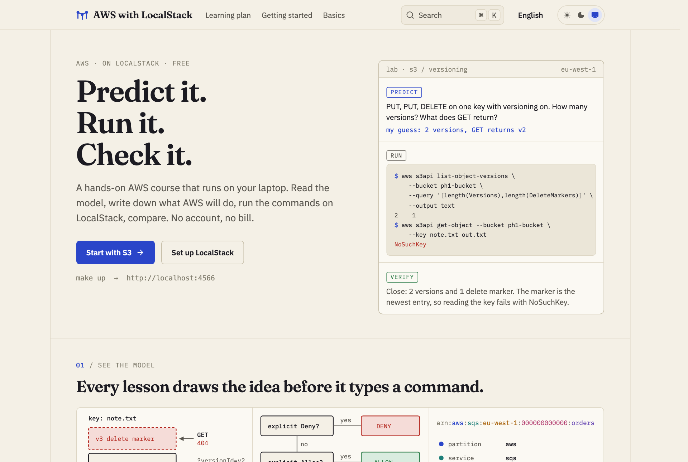
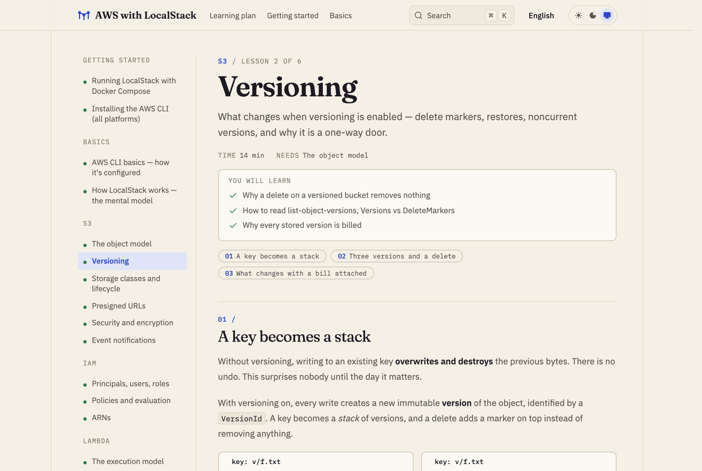
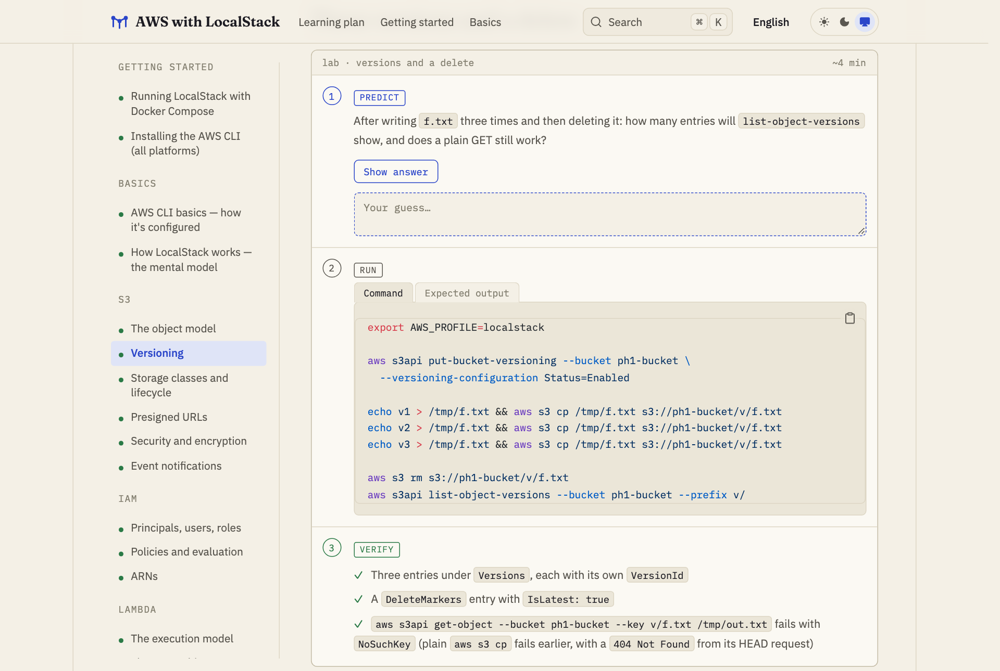
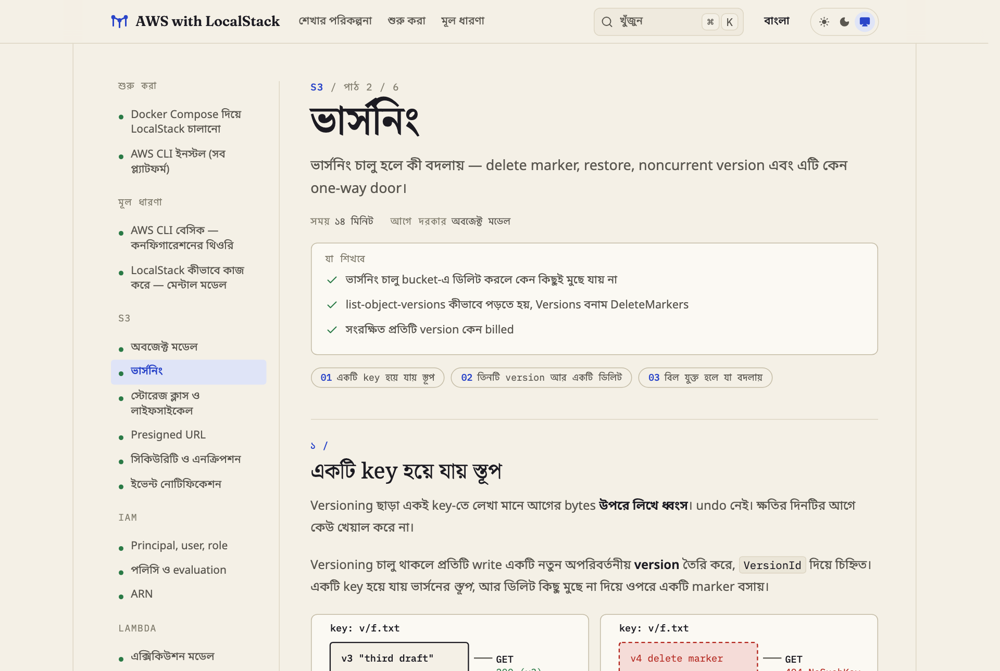

<div align="center">

# AWS with LocalStack

**Learn AWS by running it on your laptop: predict what it will do, run it, check the result.**

A free, hands-on AWS course in English and বাংলা, built on [LocalStack](https://localstack.cloud).
No AWS account, no cloud bill.

[](https://github.com/shahadathhs/aws-with-localstack/actions/workflows/ci.yml)
[](LICENSE)


[](CONTRIBUTING.md)

[Read the course](https://aws-with-localstack.vercel.app) ·
[Quick start](#quick-start) · [Learning plan](website/content/docs/en/learning-plan.md) ·
[Contribute](CONTRIBUTING.md) · [Report a bug](https://github.com/shahadathhs/aws-with-localstack/issues/new/choose)

</div>

<picture>
  <source media="(prefers-color-scheme: dark)" srcset="docs/screenshots/landing-dark.png">
  
</picture>

## Table of contents

- [About](#about)
- [Features](#features)
- [Screens](#screens)
- [Quick start](#quick-start)
- [Usage](#usage)
- [Curriculum](#curriculum)
- [Repository layout](#repository-layout)
- [Notes](#notes)
- [Documentation](#documentation)
- [Contributing](#contributing)
- [Security](#security)
- [Acknowledgements](#acknowledgements)
- [License](#license)

## About

Most AWS tutorials hand you commands to paste. This course teaches the services themselves: the model, the
guarantees, the failure modes and what each one costs. The commands are the lab instrument, not the lesson.

Every lesson follows one loop: **read the concept, predict what AWS will do, run it on LocalStack, check your
prediction.** The gap between your guess and the real output is where the learning happens. LocalStack runs the AWS
APIs in a Docker container on your machine, so you can break things freely.

It is for developers who want to understand AWS before they are paying for it: backend engineers, students, and
anyone preparing for real AWS work.

## Features

- **Predict, run, verify labs.** Each experiment asks for your guess first, then gives the commands and a checklist.
  Every lab was run against LocalStack 2026.9.0 before it was published, and where the result differs from real AWS
  the lesson says so.
- **Diagrams of the idea before the commands**: a versioned key as a stack, the IAM decision order, how a presigned
  URL is verified, how one gateway port serves every service.
- **Real AWS notes.** What changes on the real service, what it costs, and which steps cannot be undone.
- **Honest about limits.** LocalStack does not enforce IAM and does not simulate time; the lessons call that out
  instead of pretending.
- **English and বাংলা.** Every lesson exists in both languages, kept in step by a check in CI.
- **Free and local.** Everything runs in Docker. You need a free LocalStack account token (see
  [Notes](#notes)), not an AWS account.
- **Open source.** The lessons are Markdown in this repository. Fix a mistake with a pull request.

## Screens

The course site is a [Next.js](https://nextjs.org) app built on [Fumadocs](https://fumadocs.dev), with a light and a
dark theme, search, and a phone layout. The pictures below are rendered from the real site (`make screenshots`).

<picture>
  <source media="(prefers-color-scheme: dark)" srcset="docs/screenshots/lesson-dark.png">
  
</picture>

**A lesson**: sidebar, a short header with what you will learn, numbered sections and diagrams.

<picture>
  <source media="(prefers-color-scheme: dark)" srcset="docs/screenshots/lab-dark.png">
  
</picture>

**A lab**: write your guess, reveal the answer, run the commands, tick off what you should see.

<picture>
  <source media="(prefers-color-scheme: dark)" srcset="docs/screenshots/lesson-bn-dark.png">
  
</picture>

**Every lesson in বাংলা**, with the same structure and the same commands.

## Quick start

You need [Docker](https://www.docker.com/products/docker-desktop/) running, the
[AWS CLI v2](website/content/docs/en/getting-started/install-aws-cli.mdx), `make`, and a free LocalStack auth token
from [app.localstack.cloud](https://app.localstack.cloud) (Account → Auth token).

```sh
git clone https://github.com/shahadathhs/aws-with-localstack.git
cd aws-with-localstack

cp .env.example .env     # then put your token in LOCALSTACK_AUTH_TOKEN
make up                  # start LocalStack at http://localhost:4566
make setup-cli           # one-time: create the 'localstack' AWS CLI profile in ~/.aws
make demo                # a short tour: S3, SQS and DynamoDB
```

Then follow the [learning plan](website/content/docs/en/learning-plan.md), or run the course site locally:

```sh
make site-install && make site-dev     # http://localhost:3000 (needs Node 22+ and pnpm)
```

## Usage

A plain AWS CLI profile points `aws` at LocalStack, with no wrapper needed
([official approach](https://docs.localstack.cloud/aws/connecting/aws-cli/#configuring-a-custom-profile)):

```sh
aws --profile localstack s3 mb s3://my-bucket
aws --profile localstack s3 cp file.txt s3://my-bucket/
aws --profile localstack sqs create-queue --queue-name my-queue
aws --profile localstack dynamodb list-tables
```

Drop the flag with `export AWS_PROFILE=localstack`, or use `make aws CMD='s3 ls'`. For SDKs and other tools use the
endpoint `http://localhost:4566`, the region from `.env` (default `eu-west-1`) and any credentials, for example
`test` / `test`.

| Command | What it does |
| --- | --- |
| `make up` / `make down` | Start or stop LocalStack |
| `make logs` / `make status` | Tail the logs / show which services are available |
| `make setup-cli` | One-time: write the `localstack` profile into `~/.aws` |
| `make aws CMD='s3 ls'` | Run any AWS CLI command against LocalStack |
| `make demo` | Guided demo: S3 + SQS + DynamoDB |
| `make clean` | Stop and **delete all data** |
| `make site-dev` / `make site-build` / `make site-lint` | Work on the course site |
| `make screenshots` | Re-render the README screenshots (needs Google Chrome) |
| `make help` | Every command |

> The old `awslocal` pip wrapper is deprecated by LocalStack; the profile approach replaces it.

## Curriculum

Phases 0 to 4 are written. Later phases are planned and are written as the course grows.

| Phase | Topic | Status |
| --- | --- | --- |
| 0 | **Tooling**: Docker Compose, AWS CLI, profiles, how LocalStack routes requests | written |
| 1 | **S3** (object model, versioning, storage classes, presigned URLs, security, events) and **IAM** (principals, policies, ARNs) | written |
| 2 | **Lambda**: execution model, the event object, S3 and SQS triggers | written |
| 3 | **API Gateway → Lambda → DynamoDB**: the serverless chain | written |
| 4 | **SQS, SNS, EventBridge**: messaging, retries, fan-out | written |
| 5 | **CloudWatch and Secrets Manager**: observability and config | next |
| 6 | **Terraform**: rebuild everything as code | planned |
| 7 | **Real AWS** (free tier): graduate from the sandbox | planned |

The full plan, with the concepts and experiments for each phase, is in
[`learning-plan.md`](website/content/docs/en/learning-plan.md).

## Repository layout

| Path | What it holds |
| --- | --- |
| [`website/`](website) | The bilingual course site (Next.js + Fumadocs) and every lesson in `content/docs/<lang>/<service>/` |
| [`infra/`](infra) | `compose.yaml` and the one-time setup scripts for LocalStack |
| [`labs/`](labs) | Runnable per-service experiments that go with the lessons (`make demo` lives here) |
| [`docs/`](docs) | Design principles, tokens and mockups for the site; the [lesson authoring guide](docs/lessons.md) |
| [`.github/`](.github) | CI, issue and pull request templates, Dependabot |

## Notes

- **Version.** The image is pinned to `localstack/localstack:2026.9.0` for reproducibility; bump the tag in
  `infra/compose.yaml` to upgrade. This version requires a free LocalStack account token
  (`LOCALSTACK_AUTH_TOKEN` in `.env`, see the
  [setup guide](website/content/docs/en/getting-started/localstack-compose.mdx#getting-your-token)). Older community
  releases such as `4.9.0` start without a token.
- **Persistence.** Resources are kept while the container lives. `make down` and `make up` loses them (persistence
  across restarts is a LocalStack Pro feature). `make clean` wipes everything.
- **Region.** Change it in `.env` (`AWS_DEFAULT_REGION`), then run `make setup-cli` again if the profile exists.
- **Presigned URLs.** LocalStack skips signature and expiry checks by default. The presigned URLs lesson explains
  how to turn them on with `S3_SKIP_SIGNATURE_VALIDATION=0`.

## Documentation

| Document | What it covers |
| --- | --- |
| [Learning plan](website/content/docs/en/learning-plan.md) | The curriculum: phases, concepts, experiments |
| [Setup guides](website/content/docs/en/getting-started/localstack-compose.mdx) | Docker Compose, AWS CLI, how LocalStack works |
| [Writing lessons](docs/lessons.md) | The lesson kit: labs, callouts, diagrams, Bangla rules |
| [Design](docs/README.md) | Principles, tokens and mockups for the site |
| [Contributing](CONTRIBUTING.md) | Setup, checks to run, commit and branch rules |

## Contributing

Issues and pull requests are welcome: a wrong command, a clearer explanation, a Bangla fix, a lesson you would like
to see. Read [CONTRIBUTING.md](CONTRIBUTING.md) and the [Code of Conduct](CODE_OF_CONDUCT.md). Before you open a pull
request, run the lab you changed against LocalStack and `make site-lint`.

## Security

Never put a real AWS key or your `LOCALSTACK_AUTH_TOKEN` in an issue or pull request. To report a vulnerability, see
[SECURITY.md](SECURITY.md).

## Acknowledgements

- [LocalStack](https://localstack.cloud) for the emulator that makes a free sandbox possible.
- [Fumadocs](https://fumadocs.dev) and [Next.js](https://nextjs.org) for the documentation site.
- The typefaces [Fraunces](https://fonts.google.com/specimen/Fraunces), [IBM Plex](https://www.ibm.com/plex/) and
  [Noto Sans/Serif Bengali](https://fonts.google.com/noto).

## License

[MIT](LICENSE) © Shahadath Hossen Sajib
